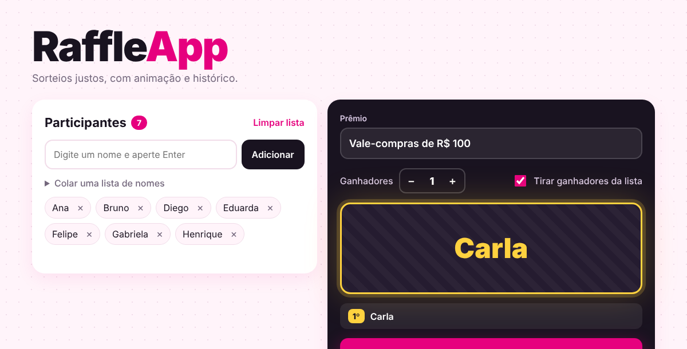

# RaffleApp — Sorteios online

Ferramenta de sorteios: cadastre participantes, sorteie com animação e guarde o histórico dos sorteios anteriores.

🔗 **[Ver o site no ar](https://iamviniciuslima05.github.io/PROJETO-RaffleApp/)**



## Funcionalidades

- Cadastro de participantes um a um ou **colando uma lista**
- Bloqueio de **nomes repetidos**
- Sorteio de **um ou mais ganhadores**
- Opção de **tirar os ganhadores** da lista para os próximos sorteios
- **Animação** estilo roleta e **chuva de confete**
- Sorteio justo com números aleatórios **criptográficos** (crypto.getRandomValues)
- **Histórico** com data, prêmio e ganhadores
- Copiar o resultado com um clique

## Tecnologias

HTML5 · CSS3 · JavaScript · Canvas · localStorage

## Estrutura

```
index.html
css/style.css
js/script.js
```

## Como rodar

Não precisa instalar nada: baixe o projeto e abra o `index.html` no navegador, ou acesse a versão publicada acima.

---
Feito por **Vinicius Lima** · [Portfólio](https://viniciuslimadev.netlify.app) · [LinkedIn](https://www.linkedin.com/in/viniciuslima25/)
